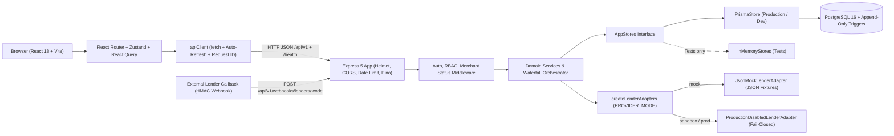

# Udyam PAY — Project Owner Learning Handbook

> **Purpose:** A complete, honest, read-only map of what actually exists across `udhyam-pay-backend` and `udyam-pay-frontend`—written so you can understand, verify, run, and navigate your entire codebase independently.
>
> **Important Reality Filter:** Every file path, function name, database table, and gap documented here was verified directly from source code. Where documentation or UI comments claim something that code does not yet do (or where tests mock PostgreSQL), this handbook tells you plainly.

---

## 1. Product Explanation

### What Problem Does Udyam PAY Solve?
Offline electronics and retail shops in India lose sales when customers cannot pay upfront and shopkeepers have to integrate or juggle separate portals for individual banks and NBFCs.

**Udyam PAY** is a **B2B2C multi-lender point-of-sale (POS) EMI financing platform**. It gives retail merchants a single dashboard and QR-checkout workflow to:
1. Onboard their shops onto one platform.
2. Record a retail purchase and customer consent.
3. Submit one financing application that automatically routes across multiple banks/NBFCs (either sequentially by priority or in parallel discovery mode) until loan offers are returned.
4. Let the customer compare EMI offers and accept one.
5. Track loan disbursement updates from the lender and earn/track platform commissions.

> **Critical Legal & Technical Distinction:** Udyam PAY is a **financing distribution and orchestration platform—NOT a bank or NBFC lender**. Credit underwriting, KYC verification, loan agreements, and money disbursement belong to lending partners.

### Users and What Each User Can Do

| User Role | Stored As (`UserRole`) | What They Can Actually Do Today |
| --- | --- | --- |
| **Merchant Owner** | `MERCHANT_OWNER` | Register a business (`PENDING_VERIFICATION`), view merchant profile/KYC status, and once `VERIFIED`: add shops, register customers + DPDP consent, record purchases, generate POS QR checkout links, create/submit financing applications, accept EMI offers, cancel eligible applications, and view commission ledger. |
| **Merchant Staff** | `MERCHANT_STAFF` | Same portal and operational permissions as `MERCHANT_OWNER` today (there is no separate staff-creation UI or endpoint yet; staff users must be created directly in DB/seeder). |
| **Platform Admins / Ops** | `ADMIN`, `SYSTEM_ADMIN`, `OPS_AGENT` | Access the `/admin` console: check system health, approve (`VERIFIED`) or `SUSPENDED` merchants, configure lender priority/enabled flags/timeouts, inspect individual applications and merchant commission ledgers by UUID, resolve `MANUAL_REVIEW` applications, and search audit logs. *(Note: Backend treats these three admin roles identically via `PLATFORM_ADMIN_ROLES`.)* |
| **Retail Customer** | `Customer` table (no `User` login) | Cannot log in. Can open a public QR URL (`/checkout/:token`) on their phone to see the purchase ticket and expiry. Self-service customer mobile offer selection is **not implemented yet**—the merchant runs the 7-step flow in-store today. |

### How the Business Workflow Operates (High Level)
1. **Merchant Onboarding:** Owner signs up -> Admin verifies merchant (`PENDING_VERIFICATION` -> `VERIFIED`) -> Owner adds retail shops.
2. **In-Store Sale:** Merchant captures customer name/phone + explicit DPDP Act consent -> records product purchase (e.g., TV, Smartphone) -> optionally generates a 30-minute QR checkout ticket.
3. **Lender Orchestration:** Merchant creates a financing application -> submits it -> backend checks eligible configured lenders and runs either a **Sequential Waterfall** (try priority #1, fall back on decline/technical failure) or **Parallel Discovery** (query participating lenders simultaneously).
4. **Offer Selection:** Available EMI plans (`3M`, `6M`, `9M`, `12M`, `0% promo`, etc.) are saved and presented -> merchant records customer acceptance of one offer -> competing offers are marked `SUPERSEDED`.
5. **Disbursement & Revenue:** When the lender confirms disbursement via signed webhook (`POST /api/v1/webhooks/lenders/:code`), the application moves to `DISBURSED`, a `CONFIRMED` `LOAN_DISBURSEMENT` transaction is recorded, and platform commission is accrued atomically.

### How the Platform Earns Revenue
- **Implemented Today (Core Engine):** In [`WebhookService.applyDisbursementEvent`](file:///c:/Users/NANDINI%20PATEL/OneDrive/Desktop/udhyam-pay-backend/src/modules/webhooks/webhook.service.ts#L664-L677), whenever a lender confirms loan disbursement, Udyam PAY automatically accrues **1.5%** of the disbursed principal (`(amountPaise * 150n) / 10000n`, rule code `DEFAULT_STANDARD_1.5PCT`) via [`CommissionService.accrue()`](file:///c:/Users/NANDINI%20PATEL/OneDrive/Desktop/udhyam-pay-backend/src/modules/ledger/commission.service.ts#L33-L70).
- **Planned (Not Implemented Yet):** Utility bill payments (BBPS) shown as a roadmap UI on `UtilitiesPage.tsx`.

### Capabilities Overview
- **Implemented End-to-End (Real Logic + PostgreSQL Persistence):** Auth & JWT refresh rotation, RBAC & tenant isolation, merchant lifecycle gating, shops, customer + DPDP consent tracking, idempotent purchases, POS QR session creation & public viewing, 15-state application workflow, sequential/discovery waterfall, EMI offer storage & acceptance, HMAC webhook verification + replay protection + double-entry commission ledger, admin verification/manual-review/audit logs.
- **Simulated Today:** Lender underwriting & offers run via JSON fixtures (`JsonMockLenderAdapter`) in non-production `PROVIDER_MODE=mock`; frontend also has static demo partner cards and quick-fill demo phone buttons.
- **Incomplete / Stubbed:** Background `ExpirationWorker` exists in code but is not started by `src/server.ts`; `CheckoutService.consumeSession()` exists but has no route calling it; 4 frontend API wrappers (`getMe`, `grantConsent`, `revokeConsent`, `getPurchase`) have no UI caller yet.
- **Planned (Missing Backend APIs):** Live bank/NBFC aggregator HTTP adapters, BBPS utility bill pay, customer mobile QR submission, underwriting document uploads, KYC/DigiLocker/credit-bureau/bank-verification/e-Sign/e-Mandate integrations, merchant staff management, admin list/analytics tables.

---

## 2. Architecture Map

Udyam PAY consists of two separate TypeScript repositories communicating over REST JSON + CORS:
- **Frontend (`udyam-pay-frontend`):** React 18 SPA built with Vite 6, React Router 7, Tailwind CSS 3, TanStack React Query 5, Zustand 5, React Hook Form 7 + Zod. Entry point: `src/main.tsx` -> `src/app/App.tsx`.
- **Backend (`udhyam-pay-backend`):** Express 5.1 modular monolith running on Node.js (`>=20.19.0`), TypeScript ESM, Pino structured logging, Zod validation, `helmet`, `cors`, and `express-rate-limit`. Entry point: `src/server.ts` -> `src/app.ts`.
- **Database & ORM:** PostgreSQL 16 (via `docker-compose.yml`) accessed through Prisma 6 (`@prisma/client`, `prisma/schema.prisma`, `src/modules/persistence/prisma-store.ts`).

### Core Cross-Cutting Mechanisms

| Mechanism | How It Works | Actual File Paths |
| --- | --- | --- |
| **API Communication** | Frontend uses native `fetch` in `apiClient` (`VITE_API_BASE_URL`, default `http://localhost:3000`) with strict CORS (`CORS_ALLOWED_ORIGINS`). No Vite proxy is used. Responses follow `{ success: true, data, meta }` or `{ success: false, error: { code, message, details, requestId } }`. | FE: `src/lib/api/client.ts`, `src/lib/config.ts`<br>BE: `src/app.ts`, `src/common/response.ts` |
| **Authentication** | Passwords hashed with `argon2` (`scrypt` fallback). Login/register issue custom HS256 JWT access tokens (15 min expiry) + 30-day opaque refresh tokens stored as SHA-256 hashes in `RefreshSession`. Refresh rotation detects token reuse and revokes the whole token family + bumps `User.tokenVersion`. FE holds `accessToken` in JS memory (`Zustand`) and `refreshToken` in `sessionStorage` to survive refreshes. | BE: `src/modules/auth/auth.service.ts`, `token.ts`, `password.ts`<br>FE: `src/stores/authStore.ts`, `src/hooks/useSessionBootstrap.ts` |
| **Authorization & Roles** | BE attaches `req.user` in `createAuthMiddleware`, enforces roles via `requireRole`, merchant ownership via `requireAuthenticatedMerchantId` / `resolveMerchantOrAdminScope`, and business status via `requireMerchantStatus`. FE mirrors route access with `ProtectedRoute` and `PublicOnlyRoute`. | BE: `src/modules/auth/auth.middleware.ts`, `src/routes/index.ts`<br>FE: `src/routes/guards.tsx`, `src/app/router.tsx` |
| **State Management** | **Frontend:** `useAuthStore` (Zustand) for session/tokens, TanStack React Query for cached server state, React `useState` for local wizard/modals. **Backend:** Stateless across requests (state persists in PostgreSQL / `PrismaStore`), except per-process `CircuitBreaker` `Map` and per-process rate limiter. | FE: `src/stores/authStore.ts`, `src/app/App.tsx`<br>BE: `src/modules/persistence/prisma-store.ts`, `src/modules/orchestration/waterfall.ts` |
| **Validation** | **Zod** validates backend env vars (`parseEnv`), every backend request schema (except `PUT /admin/lenders/:id/config`), lender JSON fixtures, and every frontend form via `zodResolver`. | BE: `src/config/env.ts`, `src/modules/*/*.routes.ts`, `src/modules/lenders/fixtures/fixture-schema.ts`<br>FE: `src/lib/validation/schemas.ts` |
| **Background Workers** | `ExpirationWorker` (`runSweep`) is written to expire stale `CheckoutSession` and `FinancingApplication` records in batches, **but it is not instantiated or scheduled in `src/server.ts`**. Checkout sessions also expire lazily when read in `CheckoutService.getSessionByToken()`. | `src/modules/workers/expiration.worker.ts`, `src/server.ts`, `src/modules/checkout/checkout.service.ts` |
| **External Integrations** | **None live.** `createLenderAdapters` selects `JsonMockLenderAdapter` (`PROVIDER_MODE=mock`) or `ProductionDisabledLenderAdapter` (`sandbox`/`production`). External lenders push callbacks to `POST /api/v1/webhooks/lenders/:code`. | `src/modules/lenders/provider-factory.ts`, `src/modules/lenders/adapters/json-mock-lender.ts`, `src/modules/webhooks/webhook.routes.ts` |

### System Architecture Diagram



---

## 3. Frontend Walkthrough (`udyam-pay-frontend`)

### Folder Structure
- `src/app/` — App shell (`App.tsx`) and route definitions (`router.tsx`).
- `src/routes/` — Route guards (`guards.tsx` + `guards.test.tsx`).
- `src/layouts/` — Page wrappers (`PublicLayout.tsx`, `DashboardLayout.tsx`).
- `src/features/` — Feature pages grouped by persona: `public/`, `checkout/`, `merchant/`, `admin/`.
- `src/components/` — Reusable UI primitives (`ui/`), async/error/empty/gap notices (`feedback/`), and domain widgets (`financial/`).
- `src/hooks/` — Auth hydration & logout hook (`useSessionBootstrap.ts`).
- `src/stores/` — Zustand auth store (`authStore.ts`).
- `src/lib/` — HTTP transport & typed API modules (`lib/api/`), BigInt INR math (`lib/money/paise.ts`), Zod schemas (`lib/validation/schemas.ts`), config, idempotency helper, status metadata.
- `src/types/` — Backend contract types (`api.ts`) and documented unbuilt contract types (`future.ts`).

### Application Entry, Routing & Layouts
1. **Entry Point (`src/main.tsx` -> `src/app/App.tsx`):** Mounts `<App />`, wrapping the tree in `<ErrorBoundary>`, TanStack `<QueryClientProvider>` (20s staleTime, smart retry skipping `400/401/403/404/409/423`), Framer `<MotionConfig>`, `<BrowserRouter>`, and `<AppShell />` (which runs `useSessionBootstrap()` once on startup).
2. **Routing (`src/app/router.tsx`) & Guards (`src/routes/guards.tsx`):**
   - **Public pages:** `/`, `/about`, `/partners`, `/utilities`, `/faq`, `/checkout/:token`.
   - **`PublicOnlyRoute` (`/login`, `/register`):** Redirects already signed-in users to `/merchant` or `/admin`.
   - **`ProtectedRoute`:** Waits while `isHydrating` is true, sends logged-out users to `/login`, and bounces wrong roles back to their own workspace home.
   - **Merchant workspace (`/merchant/*`):** Overview, `/shops`, `/financing/new`, `/applications`, `/applications/:id`, `/purchases`, `/commissions`, `/settings`.
   - **Admin workspace (`/admin/*`):** `/admin`, `/merchants`, `/lenders`, `/applications`, `/audit-logs`, `/settings`.
3. **Layouts:** `PublicLayout` shows top nav + warning banner when `isDemoEnvironment` is true. `DashboardLayout` renders desktop sidebar + mobile bottom navigation bar tailored by `isAdminRole(user.role)`, plus logout button.

### Pages & Components Highlights
- **Pages:**
  - *Public:* `LandingPage` (calls `GET /health`), `LoginPage` (quick-fill demo credentials when in demo mode), `RegisterPage`, `PartnersPage` (static demo cards), `UtilitiesPage` (`BackendRequiredNotice`), `AboutPage`, `FaqPage`.
  - *Checkout:* `CheckoutScanPage` (calls `GET /api/v1/checkout/sessions/:token` and shows QR ticket + `BackendRequiredNotice` for unbuilt customer submission).
  - *Merchant:* `MerchantOverviewPage` (KPIs + Recharts funnel/volume charts built from `purchases` & `applications`), `MerchantShopsPage`, `FinancingWizardPage` (7-step POS financing wizard), `MerchantApplicationsPage`, `MerchantApplicationDetailPage` (offers, timeline, cancel, async polling card, KYC placeholders), `MerchantPurchasesPage` (create purchase + generate QR modal), `MerchantCommissionsPage` (totals + ledger table), `MerchantSettingsPage`.
  - *Admin:* `AdminOverviewPage`, `AdminMerchantsPage` (verify/suspend by Merchant UUID), `AdminLendersPage` (update lender config by Lender UUID), `AdminApplicationsPage` (inspect by Application ID, resolve manual review, view merchant ledger), `AdminAuditLogsPage`, `AdminSettingsPage`.
- **Key Domain Components:** `MoneyDisplay` (exact `BigInt` paise rendering), `OfferCard` (`DEMO LENDER` / `0% EMI` badges), `QrTicketCard` (renders SVG QR via `qrcode.react`), `ApplicationTimeline`, `DemoModeBanner`, `BackendRequiredNotice` (explicitly marks features awaiting backend APIs instead of faking success), and `KycPrimitives` (`KycStepCard`, `DocumentUploadPlaceholder`).

### API Client, Authentication Flow, Validation & Errors
- **API Client (`src/lib/api/client.ts`):** Wraps `fetch` across 10 feature modules (`authApi`, `merchantApi`, `customerApi`, `purchaseApi`, `checkoutApi`, `applicationApi`, `offerApi`, `ledgerApi`, `adminApi`, `healthApi`). Every request generates an `X-Request-Id` header, attaches `Bearer <accessToken>` from `tokenBridge` unless `skipAuth: true`, sends `Idempotency-Key` when passed, unwraps `{ success: true, data, meta }` envelopes, and intercepts `401` responses using a single shared `refreshInFlight` promise to rotate tokens and replay the request once.
- **Auth Flow:** On login/register, `useAuthStore.setSession()` writes `refreshToken` + `{ id, email, role, merchantId }` into `window.sessionStorage` (`udyam_pay_session_v1`) while keeping `accessToken` **in RAM only**. On browser refresh, `useSessionBootstrap()` reads `refreshToken` from `sessionStorage`, sets `isHydrating: true`, calls `POST /api/v1/auth/refresh`, and restores memory `accessToken`.
- **Validation & Money Safety:** All forms use `react-hook-form` + `zodResolver` against schemas in `src/lib/validation/schemas.ts`. Currency fields validate up to 2 decimal places and convert to exact `BigInt` paise string via `parseInrInputToPaise()` (`src/lib/money/paise.ts`) so IEEE-754 floats never touch money.
- **Error Handling:** Render crashes hit `ErrorBoundary`; API/network failures become `ApiClientError` (`src/lib/api/error.ts`), mapped by `getFriendlyErrorMessage()` and rendered via `ErrorState` along with the server `requestId` for debugging.

### Five Most Important Frontend Files
1. `src/app/router.tsx` — Defines every public, checkout, merchant, and admin route with role enforcement.
2. `src/lib/api/client.ts` — Centralized `fetch` layer handling JWT injection, `X-Request-Id`, idempotency headers, error normalization, and single-flight `401` token refresh retry.
3. `src/stores/authStore.ts` — Holds the in-memory `accessToken`, manages `sessionStorage` refresh persistence, registers the `tokenBridge`, and provides role helpers.
4. `src/lib/money/paise.ts` — Provides all `BigInt` paise-to-INR formatting (`formatPaiseToInr`) and rupee-string-to-paise parsing (`parseInrInputToPaise`) with zero floating-point math.
5. `src/features/merchant/FinancingWizardPage.tsx` — Implements the core 7-step POS business flow end to end (Shop -> Customer & DPDP Consent -> Purchase & Optional QR -> Create Application -> Submit Waterfall -> Compare Offers -> Accept Offer).

---

## 4. Backend Walkthrough (`udhyam-pay-backend`)

### Folder Structure
- `src/server.ts` — Bootstraps env, Prisma, adapters, services, Express HTTP listener, and graceful shutdown.
- `src/app.ts` — Configures Express middlewares, docs routes, `/api/v1` mounting, and final error handling.
- `src/routes/index.ts` — Wires all domain routers behind public vs. authenticated boundaries.
- `src/config/` — Zod env parsing (`env.ts`), Pino logger (`logger.ts`), Prisma singleton factory (`prisma.ts`).
- `src/common/` — `AppError` classes (`errors.ts`), JSON/BigInt serialization (`response.ts`), pagination, async timeout (`async.ts`), Express middlewares (`http-logger.ts`, `rate-limit.ts`, `error-handler.ts`).
- `src/modules/` — Modular domain slices: `auth`, `merchants`, `customers`, `purchases`, `checkout`, `applications`, `offers`, `lenders`, `orchestration`, `webhooks`, `ledger`, `admin`, `health`, `persistence`, `workers`.
- `src/docs/openapi.json` — OpenAPI 3.1.0 contract served at `/docs` and `/api/docs`.
- `prisma/` — `schema.prisma`, baseline SQL migration (`migrations/20261031120000_init/migration.sql`), constraint notes (`sql/001_constraints.sql`), `seed.ts`, and `seed-demo.ts`.

### Startup, App Pipeline, Routes & Middleware
1. **Startup (`src/server.ts`):** Loads `.env`, calls `parseEnv()` (exits 1 on invalid env or if `PROVIDER_MODE=mock` in production), creates Pino logger and `PrismaClient`, builds `new PrismaStore(prisma)`, calls `createLenderAdapters(config)`, constructs 7 domain objects (`WaterfallOrchestrator`, `AuthService`, `ApplicationService`, `CheckoutService`, `OfferService`, `CommissionService`, `WebhookService`, `AdminService`), builds the Express app via `createApp()`, starts listening on `PORT`, and wires `SIGTERM`/`SIGINT`/`uncaughtException`/`unhandledRejection` shutdown with a 10s force-exit timeout.
2. **Express Setup (`src/app.ts`):** Uses dependency injection (`AppDependencies`) so integration tests can instantiate the app without opening ports or needing real Postgres. Middleware order is deliberate:
   `x-powered-by` disabled -> `trust proxy` -> `createHttpLogger` (generates/echoes `X-Request-Id` without logging headers/bodies) -> `helmet()` -> `cors()` -> **health endpoints (`/health`, `/ready`) before rate limiters** -> `createGlobalRateLimiter` -> `express.json()` (with `verify` hook saving `req.rawBody` UTF-8 string for webhook HMAC verification) -> `/docs` & `/api/docs` -> `/api/v1` router -> `notFoundHandler` -> `createErrorHandler`.
3. **Routing Order (`src/routes/index.ts`):**
   - Mounted *before* global `authMiddleware`: `/auth` (`createAuthRouter`, where `/me` explicitly receives `authMiddleware`), `/webhooks` (public lender callback verified by HMAC signature), `/checkout` (where `GET /sessions/:token` is public and `POST /sessions` explicitly attaches `authMiddleware` + `requireMerchantStatus`).
   - Then `router.use(authMiddleware)` protects all subsequent mounts: `/merchants`, `/customers`, `/purchases`, `/applications`, `/` (`offer.routes.ts`), `/ledger`, `/admin`.
4. **Validation & Errors:** Routes validate request bodies/params via Zod `.parse()`. Unhandled `ZodError`s and `express.json` parser errors are automatically normalized by `normalizeError()` (`src/common/middleware/error-handler.ts`) into `ApiErrorBody` JSON, hiding stack traces and raw DB details on `500` errors while attaching `requestId`. [`sendSuccess`](file:///c:/Users/NANDINI%20PATEL/OneDrive/Desktop/udhyam-pay-backend/src/common/response.ts#L41-L47) recursively converts all `BigInt` fields to strings before `res.json()`.

### Services, Store Interfaces, InMemoryStores, PrismaStore & Workers
- **Store Interface (`src/modules/persistence/stores.ts`):** Defines `AppStores` containing **17 domain repository interfaces** (`users`, `refreshSessions`, `merchants`, `shops`, `customers`, `consents`, `purchases`, `checkoutSessions`, `lenders`, `applications`, `lenderApplications`, `offers`, `webhooks`, `transactions`, `disbursements`, `commissions`, `auditLogs`) plus optional `runInTransaction(fn)`.
- **`InMemoryStores` (`src/modules/persistence/in-memory-store.ts`):** Implements all 17 stores using JS `Map`s and arrays, including a mutex-queued `runInTransaction` that snapshots state before running `fn` and rolls back on error. Used by automated tests so the suite runs fast with zero DB dependencies.
- **`PrismaStore` (`src/modules/persistence/prisma-store.ts`):** Implements all 17 stores against PostgreSQL using `@prisma/client`, interactive `$transaction`, `updateMany({ where: { id, version: expectedVersion } })` optimistic locking, and `P2002` unique-constraint race catching.
- **Services:** Pure TypeScript business-logic classes injected with `AppStores` (plus `adapters` / sibling services). None import Express types (`req`/`res`).
- **Workers (`src/modules/workers/expiration.worker.ts`):** `ExpirationWorker.runSweep()` queries expired `CheckoutSession` and `FinancingApplication` records in bounded batches (`batchSize = 100`) and transitions applications through `assertTransition(app.status, 'EXPIRED', { actor: 'SYSTEM' })`. **Remember:** This class is NOT wired into `src/server.ts` today.

### Ten Most Important Backend Files
1. `src/server.ts` — Process entry point: validates environment, constructs `PrismaStore`, lender adapters, services, HTTP server, and graceful shutdown.
2. `src/app.ts` — Express application factory defining security middleware order, `rawBody` capture, docs, and global error sanitization.
3. `src/routes/index.ts` — Master `/api/v1` route registry enforcing public vs. authenticated module boundaries.
4. `src/modules/auth/auth.middleware.ts` — Security gatekeepers (`createAuthMiddleware`, `requireRole`, `requireAuthenticatedMerchantId`, `resolveMerchantOrAdminScope`, `requireMerchantStatus`, `assertNoMerchantTampering`).
5. `src/modules/auth/auth.service.ts` — Implements user/merchant registration, login with 5-attempt lockout, 15m JWT issuance, and family-tracked refresh token rotation.
6. `src/modules/persistence/stores.ts` — Clean persistence boundary (`AppStores` and all 17 store interfaces + entity types) decoupling domain logic from PostgreSQL.
7. `src/modules/persistence/prisma-store.ts` — Production PostgreSQL implementation handling `$transaction`, atomic CAS version updates, and unique-violation idempotency races.
8. `src/modules/orchestration/waterfall.ts` — Multi-lender routing engine (`WaterfallOrchestrator`) supporting sequential priority fallback, parallel discovery, timeouts, and circuit breakers.
9. `src/modules/applications/application-state-machine.ts` — Explicit 15-status transition matrix (`evaluateTransition`, `assertTransition`) preventing unauthorized or invalid state jumps.
10. `src/modules/webhooks/webhook.service.ts` — Cryptographic HMAC-SHA256 + timestamp verification, replay/duplicate prevention, lender reference resolution, disbursement recording, and atomic commission accrual.

---

## 5. Database Walkthrough (`prisma/schema.prisma` & SQL Migration)

PostgreSQL is the single source of truth, modeled in `prisma/schema.prisma` (**19 tables**, **23 enums**) and materialized in `prisma/migrations/20261031120000_init/migration.sql` (including database triggers and check constraints from `prisma/sql/001_constraints.sql`).

### Models Grouped by Domain

1. **Identity & Merchants**
   - `merchants` (`Merchant`): Legal/trade name, onboarding `MerchantStatus` (`PENDING_VERIFICATION` -> `VERIFIED` | `SUSPENDED`), timestamps, suspension reason. Parent tenant FK (`merchantId`) carried on almost every merchant-owned table for fast direct tenant filtering.
   - `users` (`User`): Email (unique, lower-cased), `passwordHash` (Argon2id/scrypt), `role` (`UserRole`), `status`, nullable `merchantId` (null for admins), `tokenVersion` (instant access-token revocation counter), `failedLoginCount`, `lockedUntil`.
   - `refresh_sessions` (`RefreshSession`): Tracks login token families (`familyId`), SHA-256 `tokenHash` (unique), `expiresAt`, `revokedAt`, `replacedById`. Cascade-deletes when `User` is deleted.
   - `shops` (`Shop`): Physical retail store locations (`name`, `city`, `state`, `ShopStatus`) linked to `Merchant`.

2. **Customers, Consent & POS Checkout (DPDP Data Minimization)**
   - `customers` (`Customer`): Minimal PII (`fullName`, E.164 `phone`, `retentionExpiresAt`, `anonymizedAt`). No PAN, Aadhaar, OTPs, bank accounts, or identity documents are stored in PostgreSQL. Composite unique key `(merchantId, phone)` prevents duplicate customer records per merchant while isolating merchants from each other.
   - `customer_consents` (`CustomerConsent`): Purpose (`FINANCING_APPLICATION_PROCESSING`, `LENDER_DATA_SHARING`), `noticeVersion`, `captureMethod`, `grantedAt`, `revokedAt`.
   - `purchases` (`Purchase`): Retail item (`productCategory`, `productDescription`, `amountPaise`, `currency`), linked to `Merchant`, `Shop`, optional `Customer`, with composite unique `(merchantId, idempotencyKey)` preventing double-billing/double-creation.
   - `checkout_sessions` (`CheckoutSession`): POS QR session storing SHA-256 `tokenHash` (unique; raw `cs_...` token is never stored in DB), `status` (`ACTIVE`, `CONSUMED`, `EXPIRED`, `REVOKED`), `expiresAt`.

3. **Lenders & Routing Rules**
   - `lenders` (`Lender`): Registered lenders with unique `code` (used in webhook URLs like `/webhooks/lenders/DEMO_BANK_ALPHA` and adapter matching), `displayName`, `LenderType`, `isSimulated` flag, `status`.
   - `lender_configurations` (`LenderConfiguration`): 1-to-1 with `Lender`. Controls `enabled`, `priority` (lower number runs first), `minAmountPaise`/`maxAmountPaise`, `supportedCategories`, `supportsDiscovery`, `fallbackOnDecline`, `requestTimeoutMs`, JSON `routingRules`, and `secretRef` (**env var name only**, never raw webhook secrets in DB).

4. **Financing Application Lifecycle**
   - `financing_applications` (`FinancingApplication`): Core loan request (`status`, `routingMode`: `SEQUENTIAL` | `DISCOVERY`, `requestedAmountPaise`, `downPaymentPaise`, `requestedTenureMonths`, `version` for optimistic locking). Enforces composite unique `(merchantId, idempotencyKey)` plus a PostgreSQL **partial unique index** (`financing_applications_one_active_per_purchase`) ensuring at most one non-terminal application can exist per `purchaseId`.
   - `application_status_history` (`ApplicationStatusHistory`): **Append-only** log (`fromStatus`, `toStatus`, `actorType`, `actorId`, `reason`). Protected by DB trigger `udyam_forbid_mutation()`.
   - `lender_applications` (`LenderApplication`): One row per lender submission attempt (`attemptNo` unique with `applicationId`, unique `requestKey`, unique composite `(lenderId, externalReference)`), `outcome` (`LenderAttemptOutcome` distinguishes credit `DECLINED` from technical `TIMEOUT`/`UNAVAILABLE`), SHA-256 `responseHash`, minimal `safeResponseSummary`.
   - `financing_offers` (`FinancingOffer`): Loan terms returned by a lender (`offerType`, `status`: `ACTIVE`/`ACCEPTED`/`EXPIRED`/`WITHDRAWN`/`SUPERSEDED`, `principalPaise`, `tenureMonths`, `interestRatePercent`, `rateType`, `aprPercent`, `emiPaise`, fees, `isSimulated`). Composite unique `(lenderId, lenderOfferReference)`.

5. **Webhooks, Money Movements & Audit Trail**
   - `webhook_events` (`WebhookEvent`): Logs every inbound lender webhook (`signatureValid`, `processingStatus`, `payloadHash`, `safePayloadSummary`). Composite unique `(lenderId, eventId)` prevents duplicate event processing.
   - `transactions` (`Transaction`): Financial event record (`TransactionType`: `LOAN_DISBURSEMENT`, etc., `status`: `PENDING`/`CONFIRMED`/`FAILED`/`REVERSED`, `amountPaise`, `reconciliationStatus`). Composite unique `(lenderId, lenderTransactionRef, type)` blocks duplicate confirmed disbursement records.
   - `disbursement_statuses` (`DisbursementStatus`): **Append-only** timeline of lender disbursement state reports (protected by DB trigger).
   - `commission_entries` (`CommissionEntry`): **Append-only** double-entry commission ledger (`ACCRUAL`, `REVERSAL`, `ADJUSTMENT`; protected by DB trigger). Partial unique indexes enforce at most one `ACCRUAL` per `transactionId` and at most one `REVERSAL` per `reversesEntryId`.
   - `audit_logs` (`AuditLog`): **Append-only** administrative security log (protected by DB trigger). Indexed on `(entityType, entityId)`, `(merchantId, createdAt)`, `actorUserId`, `createdAt`.

### Why Money Uses Integer Paise (`BigInt`)
Standard JavaScript `number` / SQL floating point (`FLOAT`) cannot represent decimal fractions like `0.1 + 0.2` cleanly in binary. Storing ₹1,000.50 as integer **`100050n` (`BigInt` paise)** ensures exact rupee-and-paisa math across EMI amortization (`EmiCalculator` absorbs remainder paise into the final month so installments sum *exactly* to principal), commissions, and database `CHECK ("amountPaise" > 0)` constraints. Interest/APR rates use fixed precision `Decimal(7, 4)`. Across JSON HTTP boundaries, paise values serialize as strings (`"100050"`).

### How Prisma Talks to PostgreSQL
`src/config/prisma.ts` creates one `PrismaClient` instance using `DATABASE_URL` with `log: ['warn', 'error']` (parameter query logging is kept off to prevent PII leaks). `PrismaStore` executes queries and multi-table atomic writes inside `prisma.$transaction(async (tx) => ...)`. Because PostgreSQL `CHECK` constraints, partial unique indexes, and PL/pgSQL `BEFORE UPDATE OR DELETE` append-only triggers cannot be declared in `schema.prisma` syntax alone, they live inside `prisma/migrations/20261031120000_init/migration.sql` (copied from `prisma/sql/001_constraints.sql`).

---

## 6. End-to-End Business Workflow Trace

Below is the exact execution path through the codebase today. Steps **1–9** run from the Merchant UI; **Step 3** has an optional QR scan path that pauses before customer self-submission; Steps **10–12** happen asynchronously when an external lender (or dev script) sends a webhook.

> **UI Sequence Note:** In [`FinancingWizardPage.tsx`](file:///c:/Users/NANDINI%20PATEL/OneDrive/Desktop/udyam-pay-frontend/src/features/merchant/FinancingWizardPage.tsx), the merchant selects a Shop (Step 1), registers Customer + DPDP Consent (Step 2), records a Purchase + optional QR ticket (Step 3), creates an Application (Step 4), submits it for offers (Step 5), and picks an Offer (Step 6 -> 7).

### 1. Merchant Login
- **FE:** `LoginPage.tsx` -> form validated by `loginSchema` -> `authApi.login()` -> `apiClient.post('/api/v1/auth/login', ..., { skipAuth: true })`.
- **BE Route & Service:** `src/modules/auth/auth.routes.ts` (`POST /login`) -> `AuthService.login()` verifies email, lock status, Argon2id/scrypt hash, signs 15m JWT access token (`TokenService.signAccessToken`), creates `RefreshSession`.
- **Store / DB:** `UserStore.findByEmail`, `RefreshSessionStore.create` -> tables `users`, `refresh_sessions`.
- **Response:** `200 OK` `{ success: true, data: { user, tokens: { accessToken, refreshToken, expiresIn: 900 } } }`. FE calls `useAuthStore.setSession()` and navigates to `/merchant`.

### 2. Merchant Creates a Purchase
- **FE:** `FinancingWizardPage.tsx` (or `MerchantPurchasesPage.tsx`) converts INR to paise via `parseInrInputToPaise()` and calls `purchaseApi.createPurchase()` with `Idempotency-Key` header/key.
- **BE Route & Service:** `src/modules/purchases/purchase.routes.ts` (`POST /` guarded by `authMiddleware`, `requireMerchantStatus(stores, 'VERIFIED')`, `requireAuthenticatedMerchantId`) validates body, verifies shop and optional customer belong to `req.user.merchantId`.
- **Store / DB:** `PurchaseStore.createIdempotent()` -> checks/inserts `purchases` table enforcing `@@unique([merchantId, idempotencyKey])` + `assertPurchaseIdempotentMatch()` payload-drift check.
- **Response:** `201 Created` `{ success: true, data: { purchase } }` (with `amountPaise` as string).

### 3. Checkout Session / QR Workflow
- **Creation (Merchant side):**
  - **FE:** Merchant clicks QR button in `FinancingWizardPage` or `MerchantPurchasesPage` -> `checkoutApi.createSession()`.
  - **BE Route & Service:** `src/modules/checkout/checkout.routes.ts` (`POST /sessions`, guarded by `authMiddleware` + `VERIFIED` merchant) -> `CheckoutService.createSession()` generates random `cs_<hex>` raw token, stores only SHA-256 `tokenHash`.
  - **Store / DB:** `CheckoutSessionStore.create()` -> `checkout_sessions` table.
  - **Response:** `201 Created` `{ sessionId, status, expiresAt, qrPayload, rawToken, purchase }`. FE renders QR via `QrTicketCard` (`QRCodeSVG`).
- **Customer Scan (Public side — Partial Flow):**
  - **FE:** Customer opens `/checkout/:token` -> `CheckoutScanPage.tsx` calls `checkoutApi.getPublicSession(token)` -> `GET /api/v1/checkout/sessions/:token` -> `CheckoutService.getSessionByToken()`.
  - **Gap:** Displays purchase ticket cleanly, **then stops with `BackendRequiredNotice`**. Although `CheckoutService.consumeSession(rawToken)` exists in code (`checkout.service.ts:108`), no endpoint invokes it and no public/OTP customer submission APIs exist yet.

### 4. Customer Registration & DPDP Consent
- **FE:** `FinancingWizardPage.tsx` Step 2 validates `registerCustomerSchema` (`consentAccepted: true`) -> calls `customerApi.registerCustomer()`. *(Note: `customerApi.grantConsent()` and `revokeConsent()` exist in `customerApi.ts` for existing customers, but are not called in the UI yet.)*
- **BE Route & Service:** `src/modules/customers/customer.routes.ts` (`POST /`, `VERIFIED` merchant + `requireAuthenticatedMerchantId`) upserts customer by `(merchantId, phone)` and creates an active `CustomerConsent` for purpose `FINANCING_APPLICATION_PROCESSING`.
- **Store / DB:** `CustomerStore.findByPhone` / `.create`, `ConsentStore.create` -> tables `customers`, `customer_consents`.
- **Response:** `201 Created` `{ success: true, data: { customer, consent } }`.

### 5. Financing Application Creation
- **FE:** `FinancingWizardPage.tsx` Step 4 submits `createApplicationSchema` -> `applicationApi.createApplication()` with `Idempotency-Key`.
- **BE Route & Service:** `src/modules/applications/application.routes.ts` (`POST /`, `VERIFIED` merchant) -> `ApplicationService.createApplication()` verifies `purchase`, `shop`, and `customer` belong to merchant, checks `requestedAmountPaise <= purchase.amountPaise`.
- **Store / DB:** `ApplicationStore.create()` runs in transaction: checks idempotency key, checks no other non-terminal app exists for that `purchaseId`, creates `FinancingApplication` (`status: 'CUSTOMER_CONSENT_PENDING'`, `version: 0`), and inserts initial `ApplicationStatusHistory` row.
- **Response:** `201 Created` `{ success: true, data: { application } }`.

### 6. Application Submission
- **FE:** `FinancingWizardPage.tsx` Step 5 (or `MerchantApplicationDetailPage.tsx`) calls `applicationApi.submitApplication(application.id)`.
- **BE Route & Service:** `src/modules/applications/application.routes.ts` (`POST /:id/submit`, `VERIFIED` merchant) -> `ApplicationService.submitApplication()` checks merchant ownership, verifies `consents.findActive(app.customerId, 'FINANCING_APPLICATION_PROCESSING')`, enforces `assertTransition('CUSTOMER_CONSENT_PENDING', 'SUBMITTED')`, bumps DB status to `SUBMITTED`, then invokes `WaterfallOrchestrator.execute(submittedApp.id)`.
- **Store / DB:** `ConsentStore.findActive`, `ApplicationStore.updateStatus` (`applications`, `application_status_history`).

### 7. Lender Discovery & Waterfall
- **BE Service:** `WaterfallOrchestrator.execute()` transitions app `SUBMITTED -> LENDER_PROCESSING`, queries `stores.lenders.list('ACTIVE')` + `getConfig(lender.id)`, filters by `enabled`, `minAmountPaise`/`maxAmountPaise`, and `supportedCategories`, sorts by ascending `priority`.
- **Routing:**
  - If `routingMode === 'SEQUENTIAL'`: tries each lender in order (`executeSequentialMode`) using `invokeAdapterWithBreaker()` (checks `CircuitBreaker.tryAcquire()` and enforces `withTimeout`). Stops on `OFFERED` or `ADDITIONAL_INFORMATION_REQUIRED`; falls back on `DECLINED` or technical errors.
  - If `routingMode === 'DISCOVERY'`: fires concurrent promises across discovery-enabled lenders (`executeDiscoveryMode`), then applies offers sequentially so CAS `version` updates never collide.
- **Store / DB:** `LenderStore.list` / `.getConfig`, `LenderApplicationStore.create` -> `lenders`, `lender_configurations`, `lender_applications`.

### 8. Offer Generation
- **Adapter Execution (Simulated in Dev):** `invokeAdapterWithBreaker` calls `adapter.submitApplication(submission)`. In default `PROVIDER_MODE=mock`, [`JsonMockLenderAdapter`](file:///c:/Users/NANDINI%20PATEL/OneDrive/Desktop/udhyam-pay-backend/src/modules/lenders/adapters/json-mock-lender.ts) checks `eligibility-rules.json`, maps customer phone suffix via `scenario-fixtures.json`, and calculates exact paise EMIs via `EmiCalculator.calculate()`. In `production`, `ProductionDisabledLenderAdapter` returns `UNAVAILABLE`.
- **Persistence:** `ResultApplier.apply()` (`src/modules/orchestration/result-applier.ts`) hashes the response, updates `LenderApplication.outcome`, inserts `FinancingOffer` rows (`isSimulated: lender.isSimulated`), and transitions app `LENDER_PROCESSING -> OFFER_AVAILABLE` (requiring `lenderConfirmed: true`) if offered.
- **FE Follow-up:** `FinancingWizardPage` receives the updated application from `POST /:id/submit`; if `status === 'OFFER_AVAILABLE'`, it calls `offerApi.listOffers(updated.id)` -> `GET /api/v1/applications/:id/offers` -> `OfferService.listOffers()` returning active rows from `financing_offers`.

### 9. Offer Acceptance
- **FE:** Customer/merchant selects an `OfferCard` and clicks Accept -> `offerApi.acceptOffer(application.id, offerId)` -> `POST /api/v1/applications/:id/offers/:offerId/accept`.
- **BE Route & Service:** `src/modules/offers/offer.routes.ts` (`VERIFIED` merchant + `requireAuthenticatedMerchantId`) calls `OfferService.acceptOffer()` with `merchantId` inside `runInTransaction`.
- **Store / DB:** Inside transaction: re-reads app & offer, checks ownership and expiry (`expiresAt`), verifies `assertTransition('OFFER_AVAILABLE', 'CUSTOMER_ACCEPTED_OFFER')`, sets chosen `FinancingOffer.status = 'ACCEPTED'`, marks sibling active offers `SUPERSEDED`, updates `FinancingApplication` (`status: 'CUSTOMER_ACCEPTED_OFFER'`, increments `version`), writes `ApplicationStatusHistory`.
- **Response:** `200 OK` `{ success: true, data: { offer, applicationStatus: 'CUSTOMER_ACCEPTED_OFFER' } }`. Wizard moves to Step 7 showing acceptance confirmation.

### 10. Lender Webhook (No Frontend Trigger)
- **Trigger:** External lender HTTP `POST /api/v1/webhooks/lenders/:code` with `X-Lender-Signature` (HMAC-SHA256) and `X-Lender-Timestamp` headers (in dev, simulated manually via curl/scripts).
- **BE Route & Service:** `src/modules/webhooks/webhook.routes.ts` passes captured `req.rawBody` to `WebhookService.processWebhook()`.
  - Resolves lender by `code` and webhook secret via `secretRef` env var (never hardcoded in prod; `DEV_DEFAULT_WEBHOOK_SECRET` allowed only outside prod).
  - Verifies timestamp freshness (`±300s`) and constant-time HMAC signature (`verifySignature`).
  - Checks/inserts `webhook_events` (`@@unique([lenderId, eventId])`) to deduplicate replays.
  - Resolves target `LenderApplication` via `findByExternalReference(lender.id, externalRef)` (or validated `lenderApplicationId`/`applicationId`).

### 11. Disbursement Confirmation
- **BE Service (Inside Webhook Transaction):** For `LOAN_DISBURSED` or `DISBURSEMENT_SUCCESSFUL`, `WebhookService.applyDisbursementEvent()` verifies app status is `CUSTOMER_ACCEPTED_OFFER`, `LENDER_FINAL_CONFIRMATION`, or `DISBURSEMENT_PENDING` and checks no `CONFIRMED` `LOAN_DISBURSEMENT` transaction already exists.
- **Store / DB:** Inside `runInTransaction`: appends `DisbursementStatus` (`state: 'DISBURSED'`), steps `FinancingApplication` through state-machine transitions to `DISBURSED` (setting `terminalAt`, writing `ApplicationStatusHistory` rows), and inserts a `Transaction` (`type: 'LOAN_DISBURSEMENT'`, `status: 'CONFIRMED'`, `reconciliationStatus: 'MATCHED'`).

### 12. Commission Accrual
- **BE Service (Same Webhook Transaction):** Immediately after creating the `Transaction`, `applyDisbursementEvent()` computes `1.5%` commission in `BigInt` paise and calls `CommissionService.accrue(..., txStores)`.
- **Store / DB:** `CommissionStore.accrue()` inserts an `ACCRUAL` row into append-only `commission_entries` referencing `merchantId`, `applicationId`, and `transactionId`. Partial unique index guarantees at most one accrual per transaction; if commission accrual throws inside `$transaction`, disbursement status/transaction roll back atomically!
- **FE Viewing:** Merchant inspects accrued/net totals later on `MerchantCommissionsPage` (`GET /api/v1/ledger/commission` -> `CommissionService.getMerchantSummary()`).

---

## 7. Real vs. Simulated Functionality

| Area / Feature | Status | Detailed Reality |
| --- | --- | --- |
| **Auth, JWT Rotation, RBAC, Tenant Scoping, Lockout** | **Fully Implemented (Internal)** | Real Argon2id/scrypt hashing, HS256 JWT, family token rotation, 5-try lockout, strict tenant & status middlewares (`auth.service.ts`, `auth.middleware.ts`). |
| **Merchants, Shops, Customers, DPDP Consents, Purchases, Applications, Commissions, Audit Logs** | **Fully Implemented (Internal)** | Full REST endpoints, Zod validation, `AppStores` interfaces, `PrismaStore` SQL persistence, double-entry ledger, and state machine transitions. |
| **POS QR Checkout Session** | **Partially Implemented** | Creation (`POST /checkout/sessions`), SHA-256 token hashing, SVG QR display (`QrTicketCard`), and public ticket view (`GET /checkout/sessions/:token`) are real. Customer self-service completion & `consumeSession()` route wiring are missing. |
| **Lender Underwriting, Eligibility, Offers & Waterfall** | **JSON / Mock Provider** | When `PROVIDER_MODE=mock` (default in dev), `JsonMockLenderAdapter` simulates delays, eligibility, declines, and EMI offers using `demo-lenders.json`, `eligibility-rules.json`, and `scenario-fixtures.json` (phone suffixes `0001`–`0010`), stamping offers `isSimulated: true`. Frontend adds static `DEMO_PARTNERS` (`PartnersPage`), `DEMO_PHONE_SCENARIOS` (`FinancingWizardPage`), and `LandingPage` illustration card. |
| **Sandbox Integrations** | **Not Implemented (Fail-Fast)** | `PROVIDER_MODE='sandbox'` is parsed by `env.ts`, **but `provider-factory.ts` throws `IntegrationConfigurationError` because no HTTP sandbox client is implemented**. |
| **Disabled Production Integrations** | **Fail-Closed Stub** | `PROVIDER_MODE='production'` mounts `ProductionDisabledLenderAdapter`, which strictly rejects mock fallback and returns `{ outcome: 'UNAVAILABLE', errorCode: 'AGGREGATOR_NOT_CONFIGURED', isSimulated: false }`. |
| **Webhooks (`LOAN_DISBURSED` / `LOAN_DECLINED`)** | **Real Engine / Manual Trigger in Dev** | Real HMAC-SHA256 verification, replay window, idempotency, and transactional disbursement + commission accrual (`webhook.service.ts`). In dev/testing, triggered manually because no live lender hits it. |
| **KYC & Credit Underwriting (PAN, DigiLocker, Credit Bureau)** | **Planned Only** | Explicitly NOT stored in DB (`schema.prisma` data minimization) and NOT integrated. Shown as `PENDING` checklist items (`KycPrimitives.tsx`) on `MerchantApplicationDetailPage`. |
| **Bank Verification, e-Sign, e-Mandate, Payment/Disbursement Rails** | **Planned Only** | No penny-drop verification, Aadhaar KFS e-Sign, e-NACH/UPI Autopay mandate, or live payout/settlement API integrations exist. Listed only as future UI contracts (`future.ts` / `futureClosingChecklist`). |
| **Utility / BBPS Bill Pay & Admin/Merchant Directories** | **Planned Only** | `UtilitiesPage.tsx`, merchant staff/customer tables, document upload, and admin directories show honest `BackendRequiredNotice` states waiting for new backend endpoints. |
| **Expiration & DPDP Retention Workers** | **Incomplete / Unwired** | `ExpirationWorker` exists in `src/modules/workers/expiration.worker.ts` (tested in memory), **not started in `server.ts`**. Automatic DPDP customer retention anonymization is mentioned in `README.md` but **does not exist in code**. |
| **Live PostgreSQL Execution** | **Unverified by Automated Tests** | All automated Vitest tests run against `InMemoryStores` or mocked `PrismaClient` objects. Baseline migration triggers, check constraints, and `PrismaStore` queries have not been executed against live PostgreSQL by the test suite. |

---

## 8. Security and Reliability Engineering

| Control | How Udyam PAY Implements It | Exact Files & Symbols |
| --- | --- | --- |
| **JWT Authentication** | Custom HS256 JWT (`node:crypto` HMAC + `timingSafeEqual`), 15-min TTL, embedded `tokenVersion` checked live against DB on every authenticated request, plus opaque 30-day `RefreshSession` rotation where token reuse revokes the entire `familyId` and bumps `tokenVersion`. FE stores `accessToken` in JS memory only. | `src/modules/auth/token.ts` (`TokenService`), `auth.service.ts` (`refreshTokens`), FE `src/stores/authStore.ts` |
| **RBAC** | Static role groups (`PLATFORM_ADMIN_ROLES`: `ADMIN`, `SYSTEM_ADMIN`, `OPS_AGENT`; `MERCHANT_ROLES`: `MERCHANT_OWNER`, `MERCHANT_STAFF`) enforced via `requireRole()`, `isPlatformAdminRole()`, `isMerchantRole()`. | `src/modules/auth/auth.middleware.ts`, FE `src/routes/guards.tsx` |
| **Merchant Tenant Isolation** | Merchant routes derive `merchantId` strictly from the verified JWT user via `requireAuthenticatedMerchantId()`. `assertNoMerchantTampering()` rejects mismatched `merchantId` in query/body; routes verify shop/customer/purchase/application ownership before mutating; non-merchant roles cannot pass merchant checks even if `merchantId` is forged. | `src/modules/auth/auth.middleware.ts` (`requireAuthenticatedMerchantId`, `assertNoMerchantTampering`, `resolveMerchantOrAdminScope`) |
| **Merchant Lifecycle Gating** | `requireMerchantStatus(stores, ...)` restricts state-changing financial actions (`POST /merchants/shops`, `/customers`, `/consents`, `/purchases`, `/checkout/sessions`, `/applications`, `/submit`, `/offers/:id/accept`) to `VERIFIED` merchants. Deliberate policy exceptions allow `PENDING_VERIFICATION` merchants to revoke customer consent (`DELETE /consents/:consentId`) and cancel applications (`POST /applications/:id/cancel`). Platform admins bypass status gating. | `src/modules/auth/auth.middleware.ts` (`requireMerchantStatus`), `application.routes.ts`, `customer.routes.ts`, `merchant.routes.ts`, `purchase.routes.ts`, `offer.routes.ts`, `checkout.routes.ts` |
| **Consent Ownership & Enforcement** | `DELETE /customers/:id/consents/:consentId` verifies UUID syntax, checks the customer belongs to the merchant AND the consent belongs to both that customer and merchant (returns `404` on mismatch). `ApplicationService.submitApplication()` blocks submission (`409 Conflict`) unless `consents.findActive(customerId, 'FINANCING_APPLICATION_PROCESSING')` exists. | `src/modules/customers/customer.routes.ts`, `src/modules/applications/application.service.ts` (`submitApplication`) |
| **Idempotency** | Duplicate network retries safely return the original record when payload matches—or reject payload drift with `409 Conflict` (`assertPurchaseIdempotentMatch`, `assertApplicationIdempotentMatch`). Backed by composite unique indexes `(merchantId, idempotencyKey)` and `P2002` race handling. Webhooks deduplicate via `(lenderId, eventId)`. | `src/modules/persistence/idempotency.ts`, `prisma-store.ts` (`purchases.createIdempotent`, `applications.create`), `webhook.service.ts`, FE `src/lib/idempotency.ts` |
| **Database Transactions** | Multi-table state changes execute inside `runInTransaction()`: `OfferService.acceptOffer()` (accept offer + supersede others + update app + history), `WebhookService.validateAndApplyWebhook()` (disbursement status + app transitions + transaction + commission accrual), and `ApplicationStore` operations. `PrismaStore` uses `prisma.$transaction`; `InMemoryStores` serializes transactions with snapshot rollback. | `src/modules/persistence/prisma-store.ts` (`withTransaction`), `in-memory-store.ts` (`runInTransaction`), `offer.service.ts`, `webhook.service.ts` |
| **Optimistic Concurrency** | `FinancingApplication` carries an integer `version` column. `PrismaStore.applications.updateStatus()` performs `updateMany({ where: { id, version: expectedVersion }, data: { version: { increment: 1 } } })`. If `count === 0` (another request updated first), it throws `ConflictError` and rolls back the transaction. | `src/modules/persistence/prisma-store.ts` (`applications.updateStatus`), `in-memory-store.ts` |
| **Webhook Signatures & Replay Protection** | `app.ts` captures exact UTF-8 `req.rawBody` before parsing. `WebhookService.verifySignature()` enforces `X-Lender-Timestamp` freshness (`toleranceSeconds = 300`), computes HMAC-SHA256 over `${timestamp}.${rawPayload}`, compares digests with `timingSafeEqual()`, logs invalid-signature rejections, and deduplicates `eventId` per lender. | `src/app.ts`, `src/modules/webhooks/webhook.service.ts` (`verifySignature`, `processWebhook`) |
| **Circuit Breakers** | Per-lender `CircuitBreaker` (`CLOSED` -> `OPEN` after 3 technical failures -> `HALF_OPEN` after 30s). `tryAcquire()` issues an epoch-bound `CircuitPermit` limiting `HALF_OPEN` trial probes (`maxHalfOpenConcurrent = 1`) and ignoring stale settlement callbacks from older epochs. | `src/modules/lenders/circuit-breaker.ts` (`CircuitBreaker`), `src/modules/orchestration/waterfall.ts` (`invokeAdapterWithBreaker`) |
| **Audit Logs** | `AdminService` records immutable `AuditLog` entries for `merchant.verified`, `merchant.suspended`, `lender_config.updated`, and `application.manual_review_resolved`. Trigger `udyam_forbid_mutation()` blocks `UPDATE`/`DELETE` on `audit_logs`, `application_status_history`, `commission_entries`, and `disbursement_statuses`. *(Note: Non-admin application changes record to `application_status_history`, not `audit_logs`.)* | `src/modules/admin/admin.service.ts`, `prisma/migrations/20261031120000_init/migration.sql` |
| **Financial Precision** | Zero floating-point math for currency. All money stored in PostgreSQL `BigInt`, computed in `BigInt` (`EmiCalculator`, `WebhookService`, FE `paise.ts`), validated by SQL `CHECK ("amountPaise" > 0)` rules, and serialized safely as strings (`serializeBigInts`). | `src/modules/lenders/emi-calculator.ts`, `src/common/response.ts`, `prisma/sql/001_constraints.sql`, FE `src/lib/money/paise.ts` |

---

## 9. Development and Testing Guide

All commands below were inspected directly from `udhyam-pay-backend/package.json` and `udyam-pay-frontend/package.json`.

### 1. Start PostgreSQL & Configure Environment (Backend)
1. Copy `.env.example` to `.env` in `udhyam-pay-backend` and keep `PROVIDER_MODE=mock` for local development. Ensure `DATABASE_URL` matches `POSTGRES_*` values.
2. Start local Postgres 16 container (bound to `127.0.0.1:5432`):
   ```bash
   npm run db:up
   ```
   *(To stop the container cleanly without wiping volumes: `npm run db:down`. Avoid `docker compose down -v` unless you intend to wipe local DB data.)*

### 2. Generate Prisma Client, Run Migrations Safely & Seed Demo Data
Run inside `udhyam-pay-backend`:
```bash
# 1. Generate @prisma/client types from prisma/schema.prisma
npm run prisma:generate

# 2. Validate schema syntax
npm run prisma:validate

# 3. Apply committed migrations safely (non-destructive)
npm run prisma:migrate:deploy
# (Use `npm run prisma:migrate:dev` ONLY when authoring new schema changes locally)

# 4. Seed demo lenders + admin@udyam.example + owner@apex.example
npm run seed:demo
```
*(Safety check: `prisma/seed-demo.ts` and `prisma/seed.ts` block demo seeding if `NODE_ENV=production` unless `ALLOW_DEMO_SEED=true`.)*

### 3. Start Backend and Frontend Servers
- **Backend (`udhyam-pay-backend`, port `3000`):**
  ```bash
  npm run dev          # Hot-reload dev server via tsx watch src/server.ts
  # OR production build & run:
  npm run build && npm start
  ```
- **Frontend (`udyam-pay-frontend`, port `5173`):**
  1. Ensure `.env` has `VITE_API_BASE_URL=http://localhost:3000` and `VITE_PROVIDER_MODE_LABEL=demo`.
  2. Run:
  ```bash
  npm run dev          # Starts Vite strictly on http://localhost:5173
  ```

### 4. Testing, Typechecking & Linting

| Check | Backend Command (`udhyam-pay-backend`) | Frontend Command (`udyam-pay-frontend`) |
| --- | --- | --- |
| **All Tests** | `npm test` (`vitest run` across unit/integration/e2e — uses `InMemoryStores` + mocked `PrismaClient`) | `npm test` (`vitest run` — React Testing Library + JSDOM) |
| **Targeted Suites** | `npm run test:unit`, `npm run test:integration`, `npm run test:e2e`, `npm run test:verify` (`scripts/run-verify.js`) | `npm run test:watch` |
| **Typecheck** | `npm run typecheck` (`tsc --noEmit`) | `npm run typecheck` (`tsc --noEmit`) |
| **Lint** | `npm run lint` (`eslint .`) | `npm run lint` (`eslint .`) |
| **Build** | `npm run build` (`tsc -p tsconfig.build.json`) | `npm run build` (`tsc -b && vite build`) |

### 5. How to Debug a Failed API Request
1. **Grab the `Request ID`:** When a request fails in the UI, `ErrorState` displays both the friendly message and the `requestId` (`X-Request-Id`), generated by `apiClient` and echoed by `createHttpLogger` (`src/common/middleware/http-logger.ts`).
2. **Inspect Browser DevTools -> Network tab:** Look at the JSON response body: `{ success: false, error: { code, message, details, requestId } }`.
   - `401 UNAUTHORIZED`: Missing/expired token, `tokenVersion` mismatch, or refresh failure.
   - `403 FORBIDDEN`: Wrong role, `PENDING_VERIFICATION`/`SUSPENDED` merchant trying a `VERIFIED`-only write route, or cross-merchant tampering.
   - `400 VALIDATION_ERROR`: Check `error.details[]` for exact Zod field paths.
   - `409 CONFLICT`: Illegal state-machine transition, duplicate active application for purchase, idempotency payload mismatch, or optimistic-lock version race.
   - `NETWORK_ERROR` (`status: 0`): Backend isn't running on `VITE_API_BASE_URL` or `CORS_ALLOWED_ORIGINS` doesn't match `http://localhost:5173`.
3. **Check Backend Terminal Logs:** Search the Pino output for that `requestId` (`id`) to see stack traces on `500 INTERNAL_ERROR` (stack traces are intentionally hidden from browser responses).
4. **Probe Health & Readiness:** Call `GET http://localhost:3000/health` (process alive) and `GET http://localhost:3000/ready` (`SELECT 1` DB connectivity -> `503` if PostgreSQL is down or migrations weren't run).

---

## 10. Technical Glossary (33 Essential Project Terms)

1. **API (Application Programming Interface):** A structured contract allowing two pieces of software to talk—here, `udyam-pay-frontend` talking to `udhyam-pay-backend` over HTTP JSON.
2. **Endpoint:** One specific HTTP method + URL path, such as `POST /api/v1/purchases` (`src/modules/purchases/purchase.routes.ts`).
3. **Middleware:** Code in Express that runs *before* or *after* route handlers—used in Udyam PAY for logging, CORS, rate limiting, JWT verification (`createAuthMiddleware`), role checking (`requireRole`), and error formatting (`createErrorHandler`).
4. **Router / Controller:** The Express layer that parses HTTP params/headers/body, invokes a service, and sends JSON—for example, `createApplicationRouter` (`application.routes.ts`).
5. **Service:** Pure domain business-logic class independent of Express HTTP objects—for example, `OfferService` or `CommissionService`.
6. **Store (Repository):** An abstraction over how data is saved/loaded (`stores.ts`), letting services run identically against `PrismaStore` (real Postgres) or `InMemoryStores` (fast tests).
7. **ORM (Object-Relational Mapping):** A library mapping database rows/tables to typed TypeScript objects. Udyam PAY uses **Prisma 6**.
8. **Schema (`schema.prisma`):** The declarative blueprint of all tables, columns, enums, and relations (`prisma/schema.prisma`).
9. **Migration:** Versioned SQL scripts transforming the live database schema cleanly—e.g. `prisma/migrations/20261031120000_init/migration.sql`.
10. **JWT (JSON Web Token):** A signed compact access token (`TokenService.signAccessToken`) proving `userId`, `role`, `merchantId`, and `tokenVersion` for 15 minutes without querying passwords each time.
11. **Refresh Token Rotation:** Exchanging a long-lived opaque refresh token for a brand-new pair (`AuthService.refreshTokens`); if an already-used token is replayed, Udyam PAY detects theft and revokes the entire `familyId`.
12. **RBAC (Role-Based Access Control):** Restricting actions by `UserRole` (`ADMIN`/`OPS_AGENT` vs `MERCHANT_OWNER`/`MERCHANT_STAFF`) in `auth.middleware.ts` and `guards.tsx`.
13. **Tenant Isolation:** Ensuring Merchant A can never view or modify Merchant B's shops, customers, purchases, applications, or commissions (`requireAuthenticatedMerchantId` + `merchantId` filters).
14. **IDOR (Insecure Direct Object Reference):** A bug where changing an `:id` in a URL exposes someone else's data. Udyam PAY specifically blocks consent IDOR (`DELETE /customers/:id/consents/:consentId`) and purchase/application IDOR by verifying ownership server-side.
15. **Idempotency:** Guaranteeing that retrying the exact same request (due to flaky mobile internet) produces the same created record instead of duplicates—implemented via `Idempotency-Key` in `PurchaseStore.createIdempotent()` and `ApplicationStore.create()`.
16. **Database Transaction:** Grouping multiple reads/writes (`$transaction`) so either **all** succeed or **all** roll back on failure—critical in `OfferService.acceptOffer()` and `WebhookService` disbursement + commission accrual.
17. **Optimistic Concurrency Control (CAS):** Using a `version` integer (`where: { id, version: expectedVersion }`) so two concurrent requests cannot silently overwrite each other's application status (`PrismaStore.applications.updateStatus()`).
18. **Append-Only Table & Trigger:** Ledger/audit tables (`application_status_history`, `audit_logs`, `commission_entries`, `disbursement_statuses`) where PostgreSQL trigger `udyam_forbid_mutation()` forbids `UPDATE` and `DELETE` forever.
19. **Webhook:** An HTTP push notification sent *to* your backend by an external system—used at `POST /api/v1/webhooks/lenders/:code` when a lender disburses or declines a loan.
20. **HMAC Signature:** A cryptographic proof (`createHmac('sha256', secret)`) over `timestamp + rawBody` proving a webhook truly came from a lender who knows the secret.
21. **Replay Protection:** Rejecting captured old requests re-sent by attackers, enforced via `toleranceSeconds = 300` timestamps and unique `(lenderId, eventId)` tracking in `webhook_events`.
22. **Circuit Breaker:** A resilience pattern (`CircuitBreaker` in `circuit-breaker.ts`) that stops calling a failing lender for 30s (`OPEN`) after 3 technical failures, then allows controlled `HALF_OPEN` test probes before resetting.
23. **Lender Waterfall (`SEQUENTIAL`):** Trying lender #1 by lowest `priority`, and automatically falling back to lender #2 if lender #1 declines or fails technically (`WaterfallOrchestrator.executeSequentialMode`).
24. **Discovery Mode (`DISCOVERY`):** Querying multiple eligible lenders concurrently via `Promise.all` (`WaterfallOrchestrator.executeDiscoveryMode`) so a customer can compare offers side by side.
25. **State Machine:** A strict rule table (`application-state-machine.ts`) defining all 15 `ApplicationStatus` values, which transitions are allowed, and which require `lenderConfirmed: true`.
26. **EMI (Reducing Balance vs. Flat):** Monthly loan repayment (`EmiCalculator`). Reducing balance charges interest on remaining unpaid principal each month; flat charges interest on initial principal; 0% promo divides principal across months with remainder paise in the final month.
27. **Paise & `BigInt`:** Storing ₹1 as `100n` integer paise using JS `BigInt` (`amountPaise`) so binary floating-point rounding bugs never corrupt financial balances.
28. **DPDP Consent:** Recording explicit, purpose-scoped customer consent (`ConsentPurpose`, `noticeVersion`) under India's Digital Personal Data Protection Act before sending customer data to lenders (`customer_consents`).
29. **POS Checkout Session:** A short-lived (default 30 min) SHA-256-hashed token (`CheckoutSession`) displayed as a QR code at a shop counter (`QrTicketCard` -> `CheckoutScanPage`).
30. **Commission Ledger (Accrual / Reversal):** Double-entry accounting table (`commission_entries`) where disbursement adds an `ACCRUAL` row and refunds/corrections add a linked `REVERSAL` row rather than editing old rows.
31. **Zod Validation:** Runtime schema library (`zod`) ensuring incoming API payloads (`src/modules/*/*.routes.ts`), env vars (`env.ts`), and frontend forms (`schemas.ts`) match exact types before logic executes.
32. **Mock / Simulated Adapter (`isSimulated`):** A deterministic offline adapter (`JsonMockLenderAdapter`) reading JSON fixture files (`scenario-fixtures.json`) so you can test multi-offer/decline/timeout UI flows safely in dev mode.
33. **Token Bridge:** The callback object registered by `useAuthStore` into `client.ts` (`registerTokenBridge`) so the HTTP layer can read memory tokens and refresh expired JWTs without circular module imports.

---

## 11. Recommended Learning Sequence

Follow these 9 focused lessons in order to master the codebase without feeling overwhelmed.

### Lesson 1: Project Boundaries & Configuration
- **Files to open:** `udhyam-pay-backend/package.json`, `udhyam-pay-backend/src/config/env.ts`, `udyam-pay-frontend/package.json`, `udyam-pay-frontend/src/lib/config.ts`.
- **Understand:** How scripts start dev/test tools, how `PROVIDER_MODE` prevents `mock` mode in production, and how FE connects via `VITE_API_BASE_URL`.
- **Exercise:** Compare `.env.example` in backend with `parseEnv()` in `src/config/env.ts` and trace what happens if `PROVIDER_MODE=mock` when `NODE_ENV=production`.
- **Check:** Verify `npm run typecheck` passes in `udhyam-pay-backend` without touching code.

### Lesson 2: Database Blueprint & Money Precision
- **Files to open:** `udhyam-pay-backend/prisma/schema.prisma`, `prisma/sql/001_constraints.sql`, `udyam-pay-frontend/src/lib/money/paise.ts`.
- **Understand:** How `Merchant` scopes multi-tenant tables, why financial fields are `BigInt` paise, and which constraints live in raw SQL triggers instead of `schema.prisma`.
- **Exercise:** Draw the foreign-key chain `Merchant -> Purchase -> FinancingApplication -> LenderApplication -> FinancingOffer -> Transaction -> CommissionEntry`.
- **Check:** Explain why `financing_applications_one_active_per_purchase` allows a customer to re-apply only after a prior application reaches `DECLINED`/`CANCELLED`/`EXPIRED`.

### Lesson 3: Backend Boot, Middleware Stack & Error Envelope
- **Files to open:** `src/server.ts`, `src/app.ts`, `src/routes/index.ts`, `src/common/response.ts`, `src/common/middleware/error-handler.ts`.
- **Understand:** How dependencies flow cleanly from `server.ts` into `createApp()`, why `/health` & `/ready` sit *before* rate limiting, why `rawBody` is captured during `express.json()`, and how `serializeBigInts` & `normalizeError` format every response.
- **Exercise:** Trace a failing `POST /api/v1/purchases` with an invalid body from `app.ts` to `createErrorHandler` and write down the JSON shape returned.
- **Check:** Confirm where `X-Request-Id` is created and echoed.

### Lesson 4: Authentication, RBAC & Tenant Isolation
- **Files to open:** `src/modules/auth/token.ts`, `auth.service.ts`, `auth.middleware.ts`, `udyam-pay-frontend/src/stores/authStore.ts`, `src/hooks/useSessionBootstrap.ts`, `src/routes/guards.tsx`.
- **Understand:** JWT verification + `tokenVersion`, refresh token family reuse revocation, `requireAuthenticatedMerchantId()` vs `resolveMerchantOrAdminScope()`, and why FE stores `accessToken` in RAM and `refreshToken` in `sessionStorage`.
- **Exercise:** Trace what happens if a `SUSPENDED` merchant calls `POST /api/v1/purchases` vs `POST /api/v1/applications/:id/cancel` vs `GET /api/v1/purchases`.
- **Check:** Explain why an `ADMIN` token whose JWT somehow had `merchantId` still fails `requireAuthenticatedMerchantId`.

### Lesson 5: The Persistence Abstraction (`stores.ts`, `InMemoryStores`, `PrismaStore`)
- **Files to open:** `src/modules/persistence/stores.ts`, `src/modules/persistence/prisma-store.ts` (`purchases` & `applications` sections), `src/modules/persistence/idempotency.ts`, `src/modules/persistence/in-memory-store.ts` (lines 50–130).
- **Understand:** How `AppStores` lets integration tests swap DB implementations, how idempotent writes handle `P2002` races, and how CAS `updateMany` protects state transitions.
- **Exercise:** Read `applications.updateStatus()` in `prisma-store.ts` and trace what happens when two requests read `version = 2` concurrently.
- **Check:** Explain why `InMemoryStores.runInTransaction` uses `txQueue` + snapshots.

### Lesson 6: POS Domain Workflow & Application State Machine
- **Files to open:** `src/modules/customers/customer.routes.ts`, `purchases/purchase.routes.ts`, `checkout/checkout.service.ts`, `applications/application-state-machine.ts`, `applications/application.service.ts`, `offers/offer.service.ts`.
- **Understand:** Ownership rules, how DPDP consent gates submission, why only lender-backed transitions can set `OFFER_AVAILABLE`/`DECLINED`/`DISBURSED`, and how `acceptOffer` supersedes competing offers atomically.
- **Exercise:** Look up every terminal state in `application-state-machine.ts` and trace which actors are permitted to trigger `CANCELLED`.
- **Check:** Point out which method in `checkout.service.ts` currently has no HTTP route calling it.

### Lesson 7: Lender Orchestration, Circuit Breakers & Mock Adapters
- **Files to open:** `src/modules/lenders/provider-factory.ts`, `adapters/json-mock-lender.ts`, `fixtures/scenario-fixtures.json`, `emi-calculator.ts`, `circuit-breaker.ts`, `orchestration/waterfall.ts`, `orchestration/result-applier.ts`.
- **Understand:** How `WaterfallOrchestrator` differs between `SEQUENTIAL` and `DISCOVERY`, how `CircuitBreaker` epoch permits work, and how `JsonMockLenderAdapter` maps phone suffixes like `+919876540010`.
- **Exercise:** Follow customer phone `+919876540001` through `JsonMockLenderAdapter.checkEligibility()` / `resolveScenario()` to see why it triggers a decline.
- **Check:** Run `npm run test:unit` in `udhyam-pay-backend` and inspect `tests/unit/waterfall.test.ts`.

### Lesson 8: Webhooks, Disbursement & Double-Entry Commission Ledger
- **Files to open:** `src/modules/webhooks/webhook.routes.ts`, `webhook.service.ts`, `src/modules/ledger/commission.service.ts`, `ledger.routes.ts`.
- **Understand:** Signature verification (`verifySignature`), replay timestamp checks, `eventId` deduplication, `findByExternalReference()`, and atomic disbursement + 1.5% commission accrual.
- **Exercise:** Trace what happens if `commissionService.accrue()` throws inside `WebhookService.validateAndApplyWebhook()`—does the `LOAN_DISBURSEMENT` transaction stay saved?
- **Check:** Run `npx vitest run tests/integration/batch-1c-webhook.test.ts` and read one test case end to end.

### Lesson 9: Frontend Architecture, Data Fetching & Financing Wizard
- **Files to open:** `udyam-pay-frontend/src/app/App.tsx`, `app/router.tsx`, `lib/api/client.ts`, `lib/validation/schemas.ts`, `features/merchant/FinancingWizardPage.tsx`, `features/checkout/CheckoutScanPage.tsx`, `components/feedback/BackendRequiredNotice.tsx`.
- **Understand:** How TanStack Query manages loading/error/caching states, how `apiClient` transparently refreshes expired tokens on `401`, and how the UI explicitly isolates unbuilt backend capabilities with `BackendRequiredNotice`.
- **Exercise:** Pick Step 3 -> 4 in `FinancingWizardPage.tsx` and list every API call and Zod schema involved.
- **Check:** Run `npm test` in `udyam-pay-frontend` to see the UI test suite pass in JSDOM.

---

## 12. Accuracy Notes, Live-PostgreSQL Gaps & Technical Debt

To help you make sound engineering decisions going forward, here is every verified gap or piece of technical debt currently in the repositories:

1. **No Live PostgreSQL Verification in Tests:** Every test in `udhyam-pay-backend/tests/` runs against `InMemoryStores` or mocked `PrismaClient` doubles. The baseline SQL migration (`prisma/migrations/20261031120000_init/migration.sql`) and its raw PostgreSQL triggers/partial indexes (`udyam_forbid_mutation`, `commission_entries_one_accrual_per_transaction`, `financing_applications_one_active_per_purchase`) **have not been verified against a live PostgreSQL instance by the test suite**.
2. **`ExpirationWorker` Is Not Scheduled in `server.ts`:** [`ExpirationWorker`](file:///c:/Users/NANDINI%20PATEL/OneDrive/Desktop/udhyam-pay-backend/src/modules/workers/expiration.worker.ts) exists and passes tests, **but `src/server.ts` never instantiates or triggers it**. Stale checkout sessions currently expire lazily only when fetched via `getSessionByToken()`; stale financing applications never expire automatically unless swept externally.
3. **DPDP Retention Anonymization Is Missing:** `udhyam-pay-backend/README.md` mentions a worker for anonymizing expired DPDP customer data, and `Customer` has `retentionExpiresAt` and `anonymizedAt` columns, **but no anonymization worker or endpoint exists in `src/`**.
4. **Admin Lender Config Lacks Zod Validation / BigInt Coercion:** `PUT /api/v1/admin/lenders/:id/config` (`src/modules/admin/admin.routes.ts:34`) passes `req.body` directly into `adminService.updateLenderConfig()` with no Zod parser. As a result, `AdminLendersPage.tsx` intentionally omits `minAmountPaise` and `maxAmountPaise` controls.
5. **Unwired Checkout & Consent Endpoints:**
   - `CheckoutService.consumeSession()` (`src/modules/checkout/checkout.service.ts:108`) is dead code today because customer mobile QR completion endpoints (`consent-and-submit`, etc.) are not built yet.
   - Four typed frontend wrappers (`authApi.getMe`, `customerApi.grantConsent`, `customerApi.revokeConsent`, `purchaseApi.getPurchase`) exist in `src/lib/api/` with zero UI callers.
6. **Stale UI/Store Comments About `/auth/me`:** Comments in `udyam-pay-frontend/src/stores/authStore.ts` and text inside `AdminSettingsPage.tsx` still say `GET /api/v1/auth/me` lacks `authMiddleware`. That backend bug was already fixed in `src/modules/auth/auth.routes.ts` (though the frontend UI still does not call `getMe()`).
7. **Unused Package Dependencies:**
   - `udhyam-pay-backend/package.json` includes `jose` and `qrcode`, neither of which is imported in `src/` (JWT uses Node `crypto` HMAC; QR SVG generation runs in the browser via `qrcode.react`).
   - `udyam-pay-frontend/package.json` includes `"udyam-pay-backend": "file:../udhyam-pay-backend"`, which is unused in frontend source files.
8. **Single-Instance In-Memory State:** `express-rate-limit` (`src/common/middleware/rate-limit.ts`) and `WaterfallOrchestrator.breakers` (`Map<string, CircuitBreaker>`) live in process memory. Horizontal scaling across multiple backend instances will require Redis/shared stores later.
9. **External Financial & Regulatory Rails Still Unbuilt:** Live lender aggregators, KYC (PAN/DigiLocker), credit bureau pulls, bank account penny-drop, KFS & Aadhaar e-Sign, e-NACH/UPI Autopay e-Mandate, real settlement payout rails, and BBPS utilities remain future integration work.

